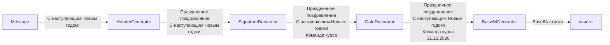
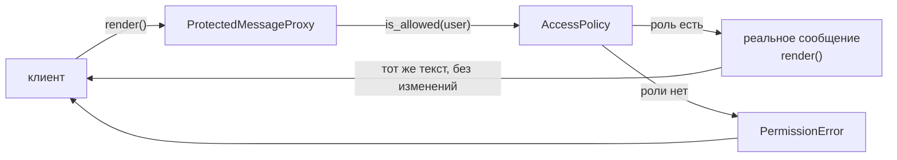
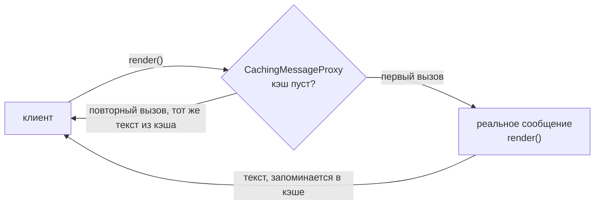
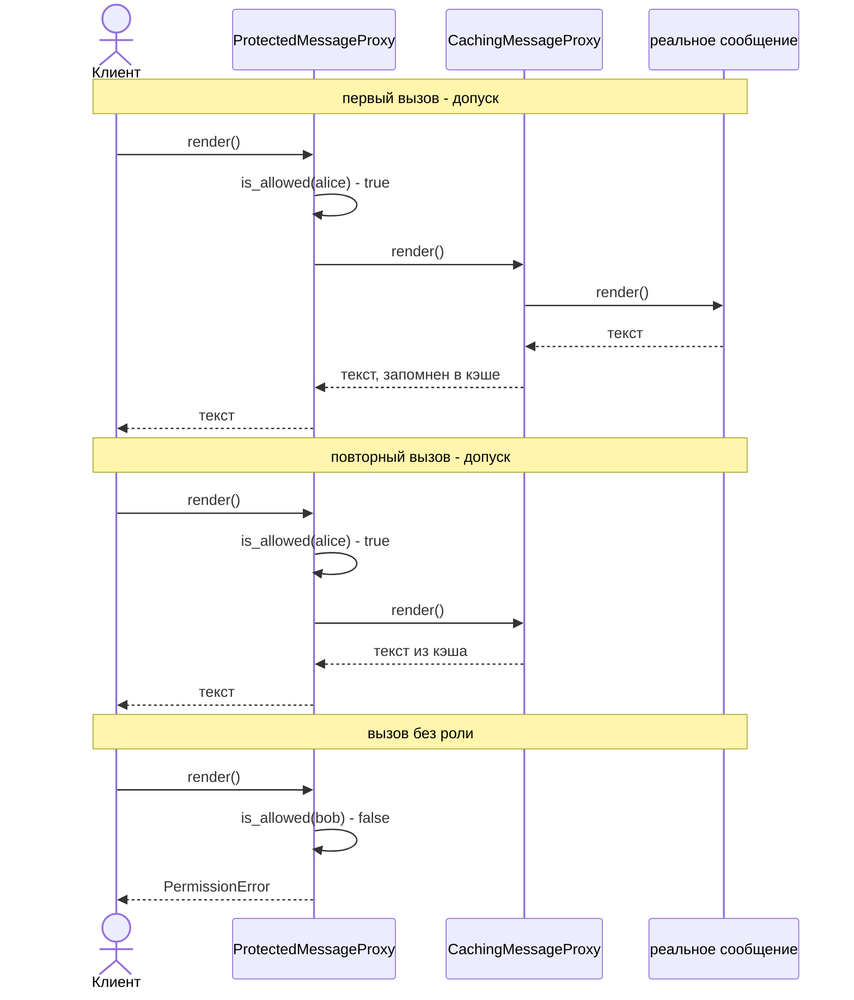

# Лабораторная работа № 2. Расширение поведения с применением Decorator и Proxy

## Цели и задачи

- Практически закрепить понимание шаблона **Decorator (Декоратор)**.
- Практически закрепить понимание шаблона **Proxy (Заместитель)**.
- Научиться различать шаблоны со сходной структурой, но разным назначением.
- Закрепить навыки модульного тестирования.

## Исходный проект

Предметная область — подготовка текстового сообщения.

В проекте уже имеются:

- интерфейс `BaseMessage`;
- базовый класс `Message`;
- модель контекста пользователя `UserContext`;
- готовая политика доступа `AccessPolicy`.

Базовый компонент возвращает исходный текст сообщения. Требуется добавить динамически комбинируемые преобразования и отдельный механизм контроля доступа.

Проверка исходного проекта:

```bash
python -m pytest
python app.py
```

## Часть 1. Decorator

Реализуйте декораторы сообщений:

1. `HeaderDecorator` — добавляет заголовок перед сообщением.
2. `SignatureDecorator` — добавляет подпись после сообщения.
3. `DateDecorator` — добавляет дату после сообщения.
4. `Base64Decorator` — возвращает всё сформированное сообщение в Base64.

Требования:

- все декораторы должны быть взаимозаменяемы с `BaseMessage`;
- декораторы должны свободно комбинироваться друг с другом;
- запрещается добавлять все варианты поведения в один класс через флаги.

## Часть 2. Proxy

Реализуйте `ProtectedMessageProxy`, который также предоставляет интерфейс `BaseMessage`, но **не изменяет содержание сообщения как Decorator**.

Proxy должен:

- хранить ссылку на реальный объект сообщения;
- использовать `AccessPolicy`;
- разрешать вызов `render()` только пользователю с необходимой ролью;
- при отсутствии доступа возбуждать `PermissionError`;
- не дублировать логику формирования текста сообщения.

## Задание и порядок выполнения

1. Изучите исходный код.
2. Реализуйте базовый класс декоратора и четыре конкретных декоратора.
3. Реализуйте защищающий Proxy.
4. Покажите в `app.py` цепочку декораторов, успешный доступ через Proxy и отказ в доступе.
5. Напишите модульные тесты для каждого декоратора, комбинаций декораторов и обоих вариантов доступа через Proxy.
6. Добавьте структурную диаграмму в `docs/`.
7. В README добавьте раздел **«Decorator и Proxy: сравнение»**.

## Дополнительное задание

По желанию можно реализовать дополнительный кэширующий, ленивый или журналирующий Proxy.

## Тестирование

```bash
python -m pip install -e ".[dev]"
python -m pytest
```

## Что должно быть в репозитории к защите

- базовый компонент;
- Decorator и четыре конкретных декоратора;
- Proxy;
- модульные тесты;
- README;
- структурная диаграмма;
- история Git.

## Вопросы к защите

1. Почему Decorator реализует тот же интерфейс, что и декорируемый объект?
2. Как достигается динамическая композиция поведения?
3. Почему наследование в этой задаче менее гибко?
4. Чем Proxy отличается от Decorator по назначению?
5. Может ли Proxy вообще не создавать реальный объект до первого обращения?
6. Какие проблемы возникают при большом количестве вложенных декораторов?

## Описание решения

### Decorator - цепочка декораторов

Назначение декоратора - добавлять поведение объекту, не меняя его интерфейс
и не плодя подклассы для класса объекта на каждый вариант. Базовый `MessageDecorator` реализует
`BaseMessage`, хранит ссылку на другой `BaseMessage` и в `render()` делегирует
ему; конкретные декораторы дополняют результат своего звена:

| Декоратор | Преобразование |
|---|---|
| `HeaderDecorator` | строка-заголовок перед текстом |
| `SignatureDecorator` | строка-подпись после текста |
| `DateDecorator` | дата в формате `%d.%m.%Y` после текста; без явной даты - текущая в момент `render()` |
| `Base64Decorator` | весь сформированный текст кодируется в Base64 (UTF-8-байты -> ascii-строка) |
 
Поток данных через цепочку (пример из `app.py`):



### Proxy - `ProtectedMessageProxy`

Назначение Proxy - контроль доступа к объекту при сохранении его интерфейса.
Proxy хранит реальный объект, политику `AccessPolicy` и пользователя
`UserContext`; пользователь внедряется конструктором, потому что сигнатура
`render()` зафиксирована интерфейсом.



Текст Proxy не формирует и не меняет - логика сообщения остаётся в базовом
компоненте и декораторах.

### Кэширующий Proxy - `CachingMessageProxy`

Первый `render()` обращается к реальному объекту и запоминает результат,
повторные возвращают сохранённую строку, не трогая субъект. Инвалидации кэша
нет: сообщение в задаче неизменяемо, усложнять нечего.



### Совместная работа Proxy

Оба Proxy реализуют `BaseMessage`, поэтому свободно компонуются:
`ProtectedMessageProxy(CachingMessageProxy(сообщение))` - защита снаружи, кэш
внутри.



Проверка доступа выполняется на каждом вызове: кэш разогревается только для
допущенных, пользователь без роли получает `PermissionError` даже при тёплом
кэше.

### Decorator и Proxy: сравнение

Структурно шаблоны почти неотличимы: и `HeaderDecorator`, и
`ProtectedMessageProxy` реализуют `BaseMessage` и хранят внутри другой
`BaseMessage`. Разница заключается в том, что происходит с результатом:

- Decorator возвращает **другой** текст: обёртка добавляет поведение и меняет
  результат;
- Proxy возвращает **тот же** текст либо не возвращает вовсе: содержание ему
  безразлично, он управляет самим обращением к объекту - пропустить его,
  отклонить, закэшировать, отложить.

На диаграммах можно увидеть разницу: в цепочке декораторов текст на
каждой стрелке растёт и до клиента доходит «заголовок + текст + подпись +
дата», у Proxy текст возвращается клиенту «без изменений» либо не доходит
вовсе.

Структурная диаграмма итоговой реализации - в [docs/README.md](docs/README.md).

### Тест-кейсы

**Декораторы сообщений**

- **Заголовок дописывается перед текстом** - обернуть сообщение заголовочным декоратором -> `render()` вернул строку с заголовком первой строкой.
- **Подпись дописывается после текста** - обернуть сообщение декоратором подписи -> `render()` вернул строку с подписью последней строкой.
- **Дата дописывается после текста** - обернуть сообщение дата-декоратором с явной датой 31.12.2026 -> `render()` вернул «текст + 31.12.2026».
- **Дата по умолчанию - сегодняшняя** - обернуть сообщение дата-декоратором без даты -> последняя строка равна сегодняшней дате.
- **Base64 кодирует весь текст** - обернуть сообщение Base64-декоратором -> `b64decode` результата `render()` вернул исходный текст.
- **Комбинация всех четырёх** - собрать цепочку `Base64(Date(Signature(Header(текст))))` -> после декодирования «заголовок + текст + подпись + дата»; внутренние декораторы переданы наружным как `BaseMessage` - взаимозаменяемость на практике.

**ProtectedMessageProxy**

- **Допуск возвращает текст субъекта без изменений** - проксировать сообщение для пользователя с ролью -> `render()` вернул тот же текст, что и прямой вызов субъекта.
- **Отказ возбуждает PermissionError и не трогает субъект** - проксировать для пользователя без роли -> возбуждён `PermissionError`, счётчик вызовов `render()` субъекта равен нулю.
- **Проверка доступа стоит до кэша** - композиция «защита снаружи, кэш внутри»: два допущенных вызова -> субъект отработал один раз; вызов без роли -> `PermissionError` при тёплом кэше.

**CachingMessageProxy**

- **Первый вызов делегирует, повторные идут из кэша** - сразу после создания счётчик вызовов субъекта ноль (ленивость); первый `render()` вернул текст субъекта (счётчик 1); повторный вернул тот же текст, счётчик остался 1.
